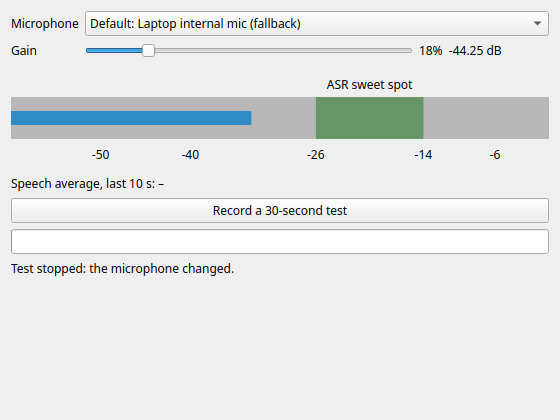

# Mic Level Light

A simple microphone level bar for Debian and Ubuntu, with the sweet spot for speech recognition (ASR) marked, a gain slider and a 30-second test.

Install the `.deb` from [Releases](https://github.com/danielrosehill/Mic-Level-Light/releases): `sudo apt install ./mic-level-light_*_all.deb`. Needs PipeWire (with pipewire-pulse) or PulseAudio.

- **Level bar**: the green band is the ASR sweet spot, average speech between -26 and -14 dBFS. The vertical line is your average speech over the last 10 s. Nothing flashes; "clipped" appears in the text for 3 s when a sample reaches full scale.
- **Gain**: the system input volume of the chosen mic, 0 to 100%. The slider is locked during a test.
- **30-second test**: average speech level, highest peak, clipped samples, background level and one recommendation in dB. It also says if another program moved the gain meanwhile. Audio is measured in memory and never saved.

The sweet spot is a working range, not a published standard. Average speech is the energy mean of the 50 ms blocks that stand above the background, counting only 100 Hz and up, so desk rumble cannot pass for voice. Peaks and clipping use the full signal. With several channels the loudest decides.

Limits: a dial on the microphone itself is separate and invisible to the computer. The app sees the signal after the system volume. If the microphone clips in its own hardware and the volume is below 100%, the flattened peaks sit below full scale and are not flagged.

For analog gain control, noise measurement and per-mic profiles see [ASR Mic Tuner](https://github.com/danielrosehill/ASR-Mic-Tuner).
